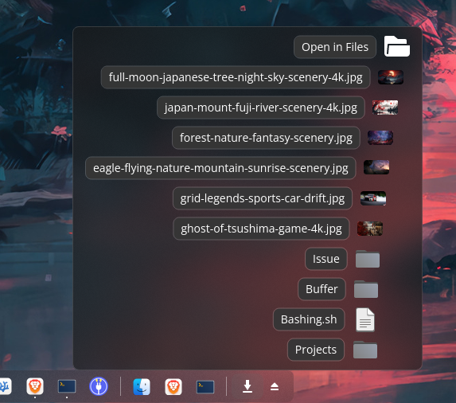
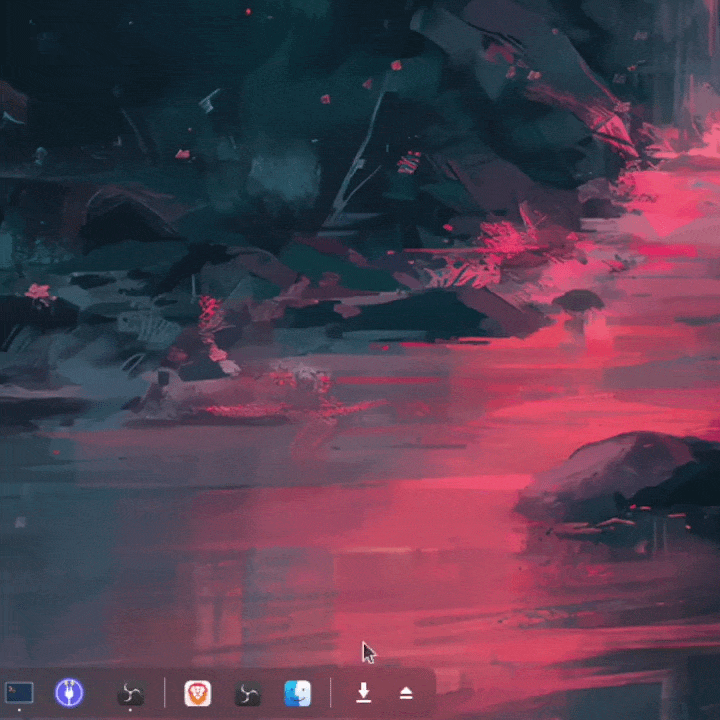

# Downloads Stack

A downloads applet for the [COSMIC](https://github.com/pop-os/cosmic-epoch) desktop panel that fans out your most recent downloads, like a Dock stack on macOS.

<table>
  <tr>
    <td></td>
    <td></td>
  </tr>
</table>

## Features

- **Recent downloads fan** - your 10 most recent files and folders, curved out from the panel and newest closest to it (on a bottom panel the newest sits at the bottom, like the Dock)
  - Click a file to open it in its default app, or **Open in Files** to open the whole folder
  - Long names are shortened in the middle, so the extension stays visible
- **Picture previews** - photos and images show a small copy of themselves instead of a file-type icon, turned the right way up and with rounded corners
  - Supports JPEG, PNG, WebP, GIF, BMP, TIFF, ICO, QOI, TGA, and SVG
  - Each picture is decoded once in the background and kept in memory, so the stack opens instantly and previews fill in as they're ready
- **Downloads in progress** - unfinished downloads get their own **Downloads** card between the fan and the panel, with a progress bar on each, updated every second
  - Shows "4.5 MB of 12 MB" for Chromium-based browsers, and a counting size with an animated bar for the rest (see [Download progress](#download-progress))
  - Marks a download **Stalled** after 30 seconds without growing, and **Interrupted** when the browser reports it failed or paused
- **Always current** - the folder is re-scanned every time the stack opens, so it is never stale
- **Tidy by default** - hidden files, `.tmp` files, and the empty placeholder Firefox writes next to a `.part` file are left out
- **Proper focus** - opened apps are raised through a Wayland activation token, the same way the stock COSMIC applets do it
- **Follows your icon theme** - file icons come from the theme picked in COSMIC Settings and update live
- **Respects XDG folders** - uses `XDG_DOWNLOAD_DIR`, falling back to `~/Downloads`

## Download progress

A partial file on its own doesn't say how big the finished download will be, so where the total comes from depends on the browser:

| Browser | Partial file | Progress shown |
|---|---|---|
| Brave, Chrome, Chromium, Vivaldi, Edge, Opera | `.crdownload` | Filling bar with received and total size |
| Firefox | `.part` | Animated bar with a counting size |
| Epiphany and others | `.download`, `.opdownload` | Animated bar with a counting size |

- **Chromium-based browsers** record each download's expected size in their `History` database. The applet copies that database to `$XDG_RUNTIME_DIR/cosmic-applet-downloads-stack/` (memory-backed), reads only the unfinished downloads (path, expected size, and state), and deletes the copy. Nothing else in your history is read. Both native and Flatpak installs of these browsers are found, across every profile.
- The browser writes to that database every few seconds, so the total can take a moment to appear after a download starts.
- While a "Save as" dialog is open, Chromium names the file `Unconfirmed 123456.crdownload` and hasn't recorded it yet, so the bar animates. The real name and total appear once you've picked where to save it.

Clicking a download in progress opens the Downloads folder.

## Installation

Downloads Stack is currently distributed as a Nix flake for NixOS.

### NixOS (flake)

Add the flake as an input to your system flake and enable the module:

```nix
{
  inputs.cosmic-applet-downloads-stack.url = "github:KemonoElite/cosmic-applet-downloads-stack";

  outputs = { nixpkgs, cosmic-applet-downloads-stack, ... }: {
    nixosConfigurations.<host> = nixpkgs.lib.nixosSystem {
      modules = [
        cosmic-applet-downloads-stack.nixosModules.default
        { programs.cosmic-applet-downloads-stack.enable = true; }
      ];
    };
  };
}
```

Then rebuild with `sudo nixos-rebuild switch`.

- Uninstall: remove the module (or set `enable = false`) and rebuild.

The flake also provides:

- `overlays.default` - adds `pkgs.cosmic-applet-downloads-stack`
- `packages.<system>.default` - for `x86_64-linux` and `aarch64-linux`
- `programs.cosmic-applet-downloads-stack.package` - swaps in another build
- `nix run github:KemonoElite/cosmic-applet-downloads-stack` - try it without installing (run it from a COSMIC session)

The flake builds with [crane](https://github.com/ipetkov/crane) and the stable Rust toolchain from [fenix](https://github.com/nix-community/fenix), the same as pop-os/cosmic-applets. It asks to use the nix-community binary cache for that toolchain; accepting saves compiling Rust.

### From source

Requires Rust, [just](https://github.com/casey/just), and the `pkg-config`, `libxkbcommon-dev`, `wayland-protocols`, and `libwayland-dev` system dependencies. Opening files uses `xdg-open`, from `xdg-utils`.

- Install: `just build-release && sudo just install`
- Uninstall: `sudo just uninstall`

## Usage

### Adding the applet to the panel

1. Open **COSMIC Settings**
2. Go to **Desktop → Panel → Configure panel applets** (or **Dock** to put it there)
3. Find **Downloads Stack** and add it

The applet appears as a download folder icon. If it isn't in the list, log out and back in so the panel picks up the new desktop entry.

### Using the stack

1. Click the icon to fan out your recent downloads
2. Click any file or folder to open it
3. Click **Open in Files** to open the Downloads folder
4. Click the icon again, or anywhere outside, to close the stack

## Configuration

There are no settings to manage; the applet reads your Downloads folder and icon theme as they are.

To change the layout, edit the constants at the top of `src/lib.rs` and rebuild:

| Constant | What it controls | Default |
|---|---|---|
| `MAX_ITEMS` | How many recent files the fan shows | `10` |
| `MAX_DOWNLOADS` | How many downloads in progress the card lists | `5` |
| `THUMBNAIL_RADIUS` | Corner rounding of picture previews, in px | `4` |
| `LABEL_MAX_WIDTH` | Widest a file name label may get, in px | `400` |
| `ARC_DEPTH` | How far the fan curves sideways at its far end, in px | `40` |
| `ROW_SPACING`, `PILL_PADDING`, ... | Spacing inside the fan | - |

## Localization

Downloads Stack is available in English and can support more languages.

To add a language, copy `i18n/en/cosmic_applet_downloads_stack.ftl` into a new locale directory under `i18n/` (for example `i18n/de/`), translate the value to the right of each `=` while leaving the keys and `{ $placeholders }` unchanged, then open a pull request. The same file holds the desktop entry's name, comment, and keywords, so `build.rs` translates those too.

File and folder names are shown exactly as they are on disk.

## Troubleshooting

### Applet not appearing in the panel settings

- Check the module is enabled and the rebuild finished: `which cosmic-applet-downloads-stack` should return a path
- Log out and back in, so the panel reloads its list of desktop entries

### "Couldn't find your Downloads folder"

Neither `XDG_DOWNLOAD_DIR` nor `~/Downloads` points to an existing folder. Check `xdg-user-dir DOWNLOAD`, and either create that folder or set the path in `~/.config/user-dirs.dirs`.

### Download size never appears

- **Firefox and other non-Chromium browsers** don't record the expected size anywhere the applet can read, so the size counts up without a total. This is expected.
- **Chromium-based browsers**: give it a few seconds after the download starts, since the browser saves its history in batches. If a "Save as" dialog is open, the total appears once you pick a location.
- A browser installed somewhere other than its usual `~/.config` or Flatpak folder won't be found.

### Wrong or generic icons on NixOS

On NixOS the panel doesn't always pass the profile folders that hold icon themes on to applets, which hides themes installed through `users.users.<name>.packages` or Home Manager. The applet adds those folders itself on startup (`src/icons.rs`), so the theme picked in COSMIC Settings should be used. If a file type still shows a generic icon, your theme has no icon for that mime type; the applet tries the specific icon (`image-png`), then the generic one (`image-x-generic`), then a symbolic fallback, so a row is never blank.

### A picture shows its icon instead of a preview

- **Unsupported format** - HEIC, AVIF, and camera RAW files aren't decoded, so they keep their file-type icon
- **Very large files** - pictures over 100 MB are skipped, to keep memory use low
- **Damaged or mislabelled files** - a file that can't be decoded keeps its icon until it changes on disk

### Files don't open

Files and folders are opened with `xdg-open`. The Nix package bundles `xdg-utils`; for a source install, make sure it's installed and that the file type has a default app.

## Development

```sh
nix develop        # toolchain, rust-analyzer, just, and the runtime libraries
just               # cargo build --release
just build-debug   # debug build
just check         # clippy, pedantic
just run           # run with debug logging (from a COSMIC session)
nix flake check    # package, clippy and unit tests
```

The project is laid out like a crate from [pop-os/cosmic-applets](https://github.com/pop-os/cosmic-applets):

- `src/lib.rs` - exposes `run()` and holds the applet and fan layout
- `src/downloads.rs` - scans the Downloads folder and detects partial files
- `src/chromium.rs` - reads expected sizes from Chromium's `History` database
- `src/thumbnails.rs` - decodes and caches picture previews
- `src/icons.rs` - makes NixOS profile icon themes visible
- `i18n/` - Fluent translation files
- `data/` - desktop entry template, metainfo, and icons
- `build.rs` - writes the translated desktop entry with `xdgen`
- `justfile` - builds and installs everything

## Packaging

Stage the install with `rootdir` and set the runtime path with `prefix`:

```sh
just build-release
just rootdir="$pkgdir" prefix=/usr install
```

This installs the binary, the desktop entry, the metainfo, and the full-colour and symbolic icons under `$rootdir$prefix`.

## Contributing

Contributions are welcome! Please open an issue or a pull request.

## License

[GNU General Public License v3.0 only](LICENSE) (`GPL-3.0-only`), the same as pop-os/cosmic-applets.

## Acknowledgments

- [System76](https://system76.com/) / [libcosmic](https://github.com/pop-os/libcosmic) - the COSMIC desktop and UI toolkit
- [pop-os/cosmic-applets](https://github.com/pop-os/cosmic-applets) - the structure this applet follows
- The macOS Dock's Downloads stack - the idea
